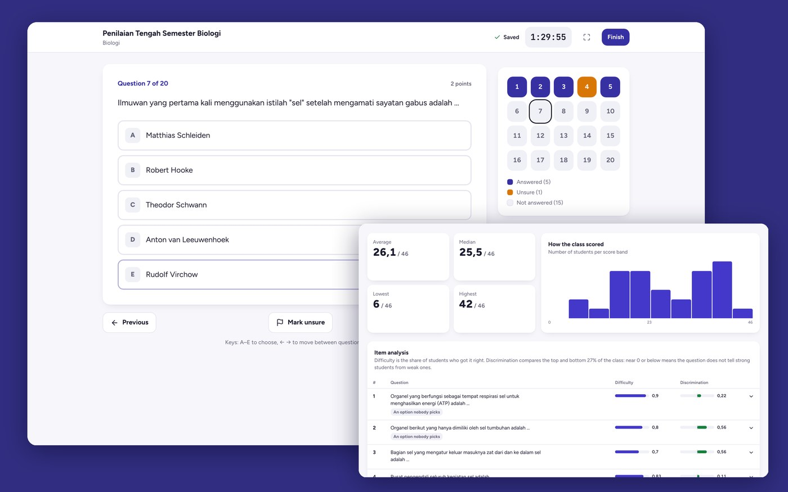
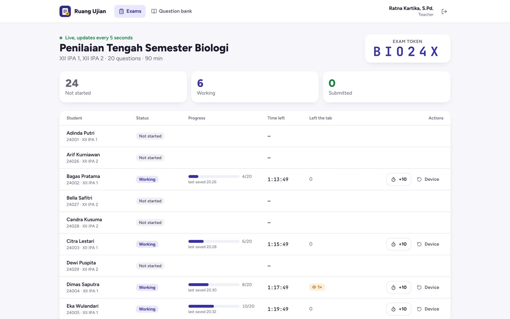
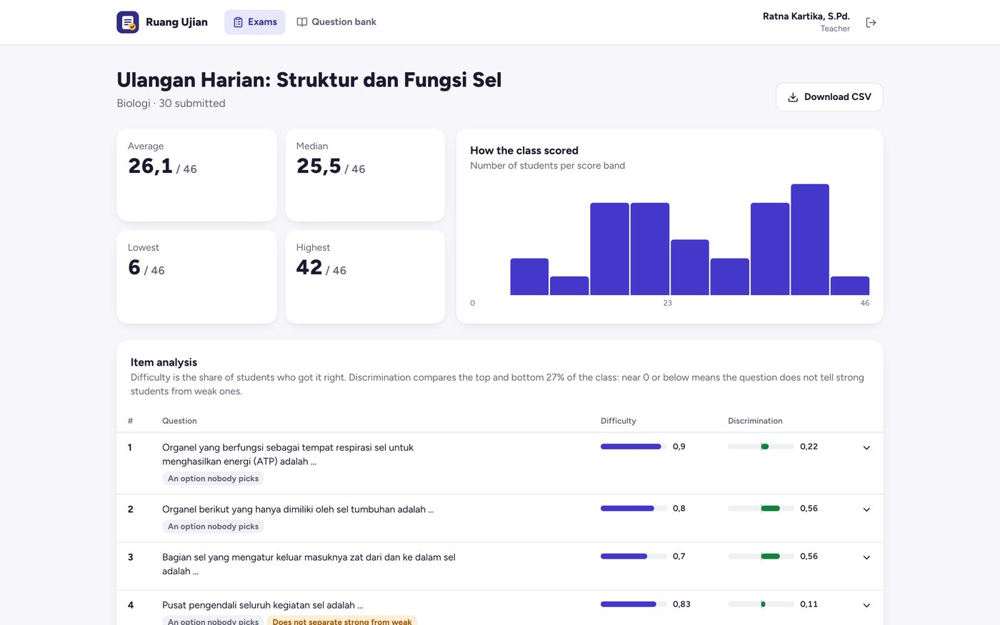
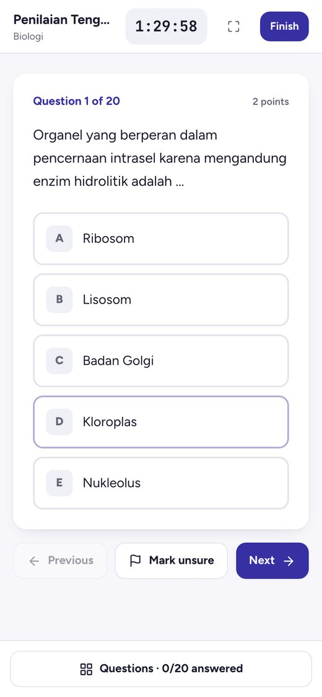

# Ruang Ujian: computer-based tests for schools

[](https://github.com/dinulimann/ruang-ujian/actions/workflows/ci.yml)



An online exam system (CBT) for **SMA Contoh Nusantara**, a fictional Indonesian high school.

- **Teachers** keep a question bank (multiple choice and essay, with pictures, imported from CSV or Excel). They schedule exams for classes and watch students live while the exam runs. Afterwards they mark the essays and read an item analysis that points out weak questions.
- **Students** enter the exam token their proctor reads out. They answer on a screen that saves every click, mark questions as *unsure* (ragu-ragu) to come back to, and see their score once marking is done.

Built with **Laravel 13** (PHP 8.4, Sanctum cookie sessions) on **PostgreSQL 17**, and a **React 19 / TypeScript / Tailwind CSS 4** single-page app. It is tested with **Pest** against a real database and with **Playwright** against the whole stack.

## What makes it fair and reliable

- **The server keeps the clock.**
  - The deadline is fixed when the student starts, and changing the device's clock changes nothing.
  - Starting late does not buy time past the exam's closing time.
  - Answers sent in the last seconds still count (10-second grace for requests already on their way); later ones are refused.
  - When time runs out, the attempt is submitted and multiple choice is marked. This happens even if the student closed the browser: a scheduler does it every minute.
- **Answers are saved on every click and never lost or rolled back.**
  - Each save carries an increasing number. The database only overwrites an answer with a newer number (`ON CONFLICT … WHERE client_seq <`), so a slow, older request cannot undo a newer one.
  - Answers given while offline wait in the browser and are sent when the connection returns, even after a page reload.
- **The answer key never reaches the browser.**
  - The exam a student loads has the questions and options in *their* shuffled order, with no correct-answer field.
  - Right answers are shown only after the exam closes, so a student who finishes early cannot pass them on.
- **One exam, one device.**
  - Starting needs the proctor's token, and the attempt is bound to the device it started on.
  - If a student has to change computers, the teacher releases the lock from the live monitor and the next device takes over.
  - Leaving the exam tab is counted and shown to the teacher.
- **Exams are snapshots.** Questions are copied into the exam when it is scheduled, so editing the bank later never changes a test students already took. Once anyone has started, the exam's questions and timing are locked.
- **Marking and analysis.**
  - Multiple choice is marked on submit. Blank essays are marked 0. The teacher marks the remaining essays in steps of 0.5, with feedback.
  - The item analysis gives each question's difficulty (share answering correctly) and discrimination (top 27% of the class against the bottom 27%), and shows how often each option was picked.
  - Questions that are too hard or too easy, that do not separate strong students from weak ones, or where weaker students do better (usually a wrong key) are flagged. The demo data has one such question on purpose.
- **Imports are all-or-nothing.** A CSV or Excel file is checked first, and if any row is wrong nothing is imported and every problem is listed with its row number.
- **Exports are safe to open in Excel.** The results CSV neutralises cells starting with `=`, `+`, `-` or `@`, so a student's name cannot run as a formula.

## Tests

| Suite | What it covers | Tests |
|---|---|---|
| Pest + PostgreSQL | no answer key in the student's paper, token / class / time-window checks, per-student shuffling, resuming, late starts, out-of-order saves, the deadline and grace period, the scheduler, device binding and release, extra time, tab counting, marking, result visibility, item analysis on a hand-checked class, CSV and Excel import, exam snapshots, access control, login throttling, CSV formula escaping | 26 |
| Playwright (full stack) | answers, unsure marks and the clock surviving a reload, offline answers sent on reconnect, device lock released by the teacher, extra time from the monitor, essay marking and the item analysis, importing a spreadsheet | 6 |

CI runs both suites against PostgreSQL, plus a Docker build.

**Limits:**
- Leaving the tab is recorded, but nothing stops it: a browser cannot lock a student in.
- There is no live demo; run it with Docker as below.
- Exams cannot be deleted from the UI.

## Run it

Requirements: Docker.

```bash
docker compose --profile app up -d --build
open http://localhost:8095
```

This starts the app (FrankenPHP), a scheduler container and PostgreSQL, with demo data:
- **Teacher:** `ratna@sma-contoh.sch.id` / `guru1234`.
- **Students:** NIS `24001` to `24030` / `siswa1234`. Students 24002–24006 are mid-exam on another "device"; use any other to take it.
- **Exam token** for the open exam: `BIO24X`.
- A finished exam has results, an item analysis and three essays left to mark.

Developing locally (PHP 8.4, Composer, Node 22):

```bash
docker compose up -d db
cd backend && composer install && cp .env.example .env && php artisan key:generate
php artisan migrate --seed && php artisan storage:link && php artisan serve    # API on :8000
cd frontend && npm ci && npm run dev                                           # http://localhost:5174/app/
```

Tests: `./vendor/bin/pest` in `backend/` (uses the `ujian_test` database), and `npm run test:e2e` in `frontend/` (builds the app, reseeds `ujian_e2e` and starts Laravel itself).

## Structure

```
backend/app/Services/AttemptService.php   starting, the clock, autosave, device binding, submitting, marking
backend/app/Services/ItemAnalysis.php     difficulty, discrimination, option counts, flags
backend/app/Services/QuestionImporter.php CSV / Excel import with per-row errors
backend/app/Services/ExamPublisher.php    exam snapshots and tokens
backend/app/Http/Controllers              student and teacher APIs
backend/database                          schema and demo data
frontend/src/pages/student/ExamRoom.tsx   the exam screen: timer, autosave queue, navigator
frontend/src/pages/teacher                question bank, exam editor, live monitor, marking, results
```

| Live monitor | Item analysis | On a phone |
|---|---|---|
|  |  |  |

SMA Contoh Nusantara and its people are fictional. The cell diagram is public domain (see [CREDITS.md](CREDITS.md)). Built by Dinul Iman.
